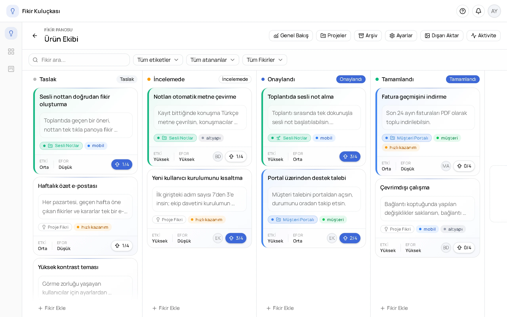
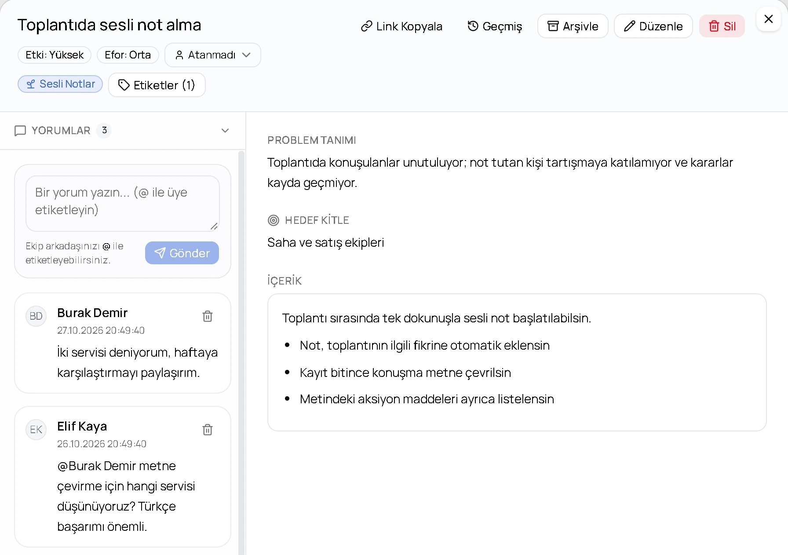
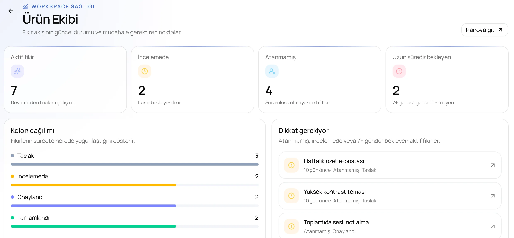
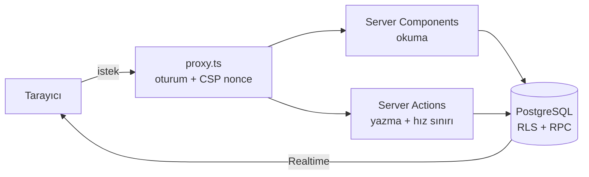

<div align="center">


# Fikir Kuluçkası

**Ekiplerin fikirlerini tek panoda topladığı, birlikte değerlendirdiği ve olgunlaşanları projeye dönüştürdüğü çalışma alanı.**

[](https://github.com/EmaHOLDING/ideamanagment/actions/workflows/ci.yml)


</div>

<picture>
  <source media="(prefers-color-scheme: dark)" srcset="public/landing/pano-dark.webp" />
  
</picture>

## Neden?

Ekiplerde fikirler kaybolmaz, dağılır: biri toplantıda söyler, biri mesajlaşma uygulamasına yazar, biri not defterine alır. Birkaç hafta sonra "bunu kim önermişti, neden vazgeçmiştik?" sorusunun cevabı kimsede olmaz.

Fikir Kuluçkası fikri, etrafındaki tartışmayı ve geçirdiği her değişikliği aynı yerde tutar.

## Özellikler

- **Kanban panosu:** Fikirler sürükle-bırak ile kolonlar arasında ilerler. Panolar hazır şablonlardan kurulur, kolonlar özelleştirilebilir.
- **Versiyon geçmişi:** Her düzenleme yeni bir versiyon olarak saklanır, eskisinin üzerine yazılmaz. Kimin neyi ne zaman değiştirdiği ve hangi alanın (başlık, problem, hedef kitle, etki…) güncellendiği her versiyonda görünür.
- **Projeler:** Olgunlaşan fikir tek adımda projeye dönüşür; problem tanımı ve hedef kitle projeye taşınır, sonraki fikirler o projenin özellikleri olarak gelişir.
- **Ekip çalışması:** Yorumlar, @etiketleme, oylama, sorumlu atama ve etiketler. Kartlar, yorumlar ve bildirimler herkese gerçek zamanlı yansır; biri bir kartı düzenlerken adı kartın üzerinde görünür.
- **Genel bakış:** İncelemede bekleyen, sorumlusu olmayan ve uzun süredir dokunulmamış fikirler ayrı bir listede toplanır.
- **Roller:** Sahip, yönetici, üye ve izleyici. Ekip arkadaşları davet linkiyle katılır.
- **İçe/dışa aktarma:** Markdown dosyasından fikir içe aktarma; panoyu PNG ya da PDF olarak dışa aktarma.
- **Geri alma ve arşiv:** Silinen öğe hemen geri alınabilir; biten fikirler silinmek yerine arşivlenir.
- **Bildirimler:** Uygulama içi bildirimler ve tercihe bağlı e-posta.
- **Rehberli tur:** İlk girişte ürün turu; sayfa bazında ipucu kartları.

<table>
  <tr>
    <td width="50%">
      <picture>
        <source media="(prefers-color-scheme: dark)" srcset="public/landing/birlikte-dark.webp" />
        
      </picture>
      <p align="center"><sub>Fikir detayı, yorumlar ve @etiketleme</sub></p>
    </td>
    <td width="50%">
      <picture>
        <source media="(prefers-color-scheme: dark)" srcset="public/landing/genel-bakis-dark.webp" />
        
      </picture>
      <p align="center"><sub>Genel bakış</sub></p>
    </td>
  </tr>
</table>

## Teknoloji

| Alan | Kullanılan |
|---|---|
| Uygulama | Next.js 16 (App Router, Server Components, Server Actions), React 19, TypeScript |
| Veri ve kimlik | Supabase: PostgreSQL, Auth (Google OAuth), Realtime, Storage |
| Arayüz | Tailwind CSS 4, shadcn/ui (Base UI), lucide-react, next-themes |
| Editör | Tiptap 3; içerik Markdown olarak saklanır |
| Sürükle-bırak | @hello-pangea/dnd |
| Doğrulama | Zod |
| E-posta | Resend |
| Test | Vitest (birim), pgTAP (veritabanı ve yetki) |
| CI | GitHub Actions |

## Mimari



Öne çıkan kararlar:

- **Yetki sınırı veritabanında.** Erişim kuralları uygulama kodunda değil, PostgreSQL'de satır düzeyinde güvenlik (RLS) politikaları ve `SECURITY DEFINER` fonksiyonlarıyla tanımlı. Bu kurallar pgTAP testleriyle CI'da her push'ta doğrulanıyor; bir politikanın sessizce gevşemesi testleri kırar.
- **Ayrı bir API katmanı yok.** Okumalar Server Component'lerde, yazmalar `app/actions/` altındaki Server Action'larda. Her yazma işlemi veritabanı tabanlı hız sınırından geçiyor.
- **Versiyonlu fikirler.** `ideas` tablosu güncel versiyona doğrudan işaretçi (`current_version_id`) tutuyor; geçmiş `idea_versions` tablosunda. Böylece panoyu çizmek için tüm geçmişi çekmek gerekmiyor.
- **Gerçek zamanlı ortak çalışma.** Supabase Realtime ile pano değişiklikleri ve bildirimler anında yansıyor; presence ile kimin hangi kartla çalıştığı görünüyor ve aynı kartı iki kişi aynı anda taşıyamıyor.
- **Güvenlik başlıkları.** İstek başına nonce'lu Content Security Policy, HSTS, `X-Frame-Options`, `nosniff`, Referrer ve Permissions Policy.
- **Gözlemlenebilirlik.** Sunucu ve tarayıcı hataları `instrumentation` kancalarıyla tek bir raporlayıcıda toplanıp e-posta veya webhook ile bildiriliyor.

## Proje yapısı

```
app/
  (app)/           Giriş gerektiren sayfalar: çalışma alanları, pano, projeler, arşiv, ayarlar
  (auth)/          Giriş sayfası
  actions/         Server Action'lar (fikir, yorum, proje, etiket, bildirim…)
  join/            Davet linkiyle katılım
  page.tsx         Tanıtım sayfası
components/
  landing/         Tanıtım sayfası ve animasyonlu demolar
  layout/          Başlık, menüler, bildirimler, ürün turu
  editor/          Tiptap editörü
  ui/              shadcn/ui bileşenleri
lib/
  supabase/        Tarayıcı, sunucu ve yönetici istemcileri; oturum yenileme
  hooks/           Realtime abonelikleri ve presence
supabase/
  migrations/      Şema, RLS politikaları ve fonksiyonlar
  tests/           pgTAP testleri
tests/             Vitest birim testleri
proxy.ts           Oturum kontrolü ve CSP
```

---

<div align="center">
<sub><b>Fikir Kuluçkası</b>, Ema Software tarafından geliştirilmiştir. © 2026 Ema Software, tüm hakları saklıdır. Ayrıntılar için <a href="LICENSE">LICENSE</a>.</sub>
</div>
